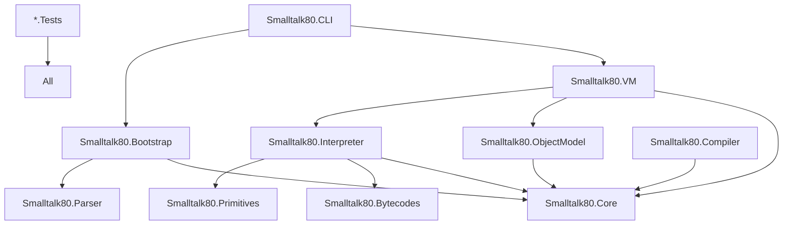

# Smalltalk-80 VM Restructuring Summary

## Overview

The Smalltalk-80 interpreter and virtual machine have been completely restructured to support a clean, JSON-driven bootstrap process. The new architecture separates concerns, uses modern C# features, and provides a maintainable foundation for the Smalltalk-80 implementation.

## Key Changes

### 1. **JSON-Driven Bootstrap**

**Before**: Multiple hardcoded bootstrap strategies in C# code
**After**: Three JSON files define the complete bootstrap process

- `bootstrap_phase1.json` - VM primitive operations for core class creation
- `bootstrap_phase2.json` - Messaging-based class and method definitions  
- `bootstrap_phase3.json` - File loading configuration for complete system

### 2. **Clean Architecture**

**Before**: Monolithic `VirtualMachine.cs` with mixed responsibilities
**After**: Separated into distinct layers with clear interfaces

```
Core/
├── Smalltalk80.Core/          # Interfaces only
├── Smalltalk80.ObjectModel/   # Object model implementation
└── Smalltalk80.VM/            # VM implementation

Bootstrap/
├── Smalltalk80.Bootstrap/     # JSON bootstrap executors
└── Smalltalk80.Bootstrap.Data # Bootstrap JSON files
```

### 3. **Interface-Driven Design**

All major components now have interfaces in the Core project:

```csharp
public interface IVirtualMachine
{
    IObjectMemory ObjectMemory { get; }
    IClassRegistry ClassRegistry { get; }
    IPrimitiveDispatcher PrimitiveDispatcher { get; }
    IInterpreter Interpreter { get; }
    
    Task BootstrapAsync(IBootstrapProvider provider);
    ISmalltalkObject? SendMessage(ISymbol selector, ISmalltalkObject receiver, params ISmalltalkObject[] arguments);
}
```

### 4. **Modern C# Features**

- **File-scoped namespaces** (C# 10)
- **Record types** for immutable data
- **Nullable reference types** throughout
- **Pattern matching** enhancements
- **Async/await** for I/O operations
- **Comprehensive XML documentation**

## How to Use the New System

### Starting the VM with JSON Bootstrap

```csharp
// Create VM instance
var vm = new VirtualMachine(new VMConfiguration
{
    EnableTracing = true,
    EnableMethodCache = true,
    BootstrapMode = BootstrapMode.Full
});

// Load bootstrap from JSON files
var bootstrapProvider = new JsonBootstrapProvider("./Bootstrap/Data");

// Execute bootstrap
await vm.BootstrapAsync(bootstrapProvider);

// VM is now ready to execute Smalltalk code
var result = vm.SendMessage(
    vm.ClassRegistry.InternSymbol("factorial"),
    vm.ObjectMemory.CreateSmallInteger(5)
);
```

### Modifying the Bootstrap

To add a new class or method to the bootstrap, simply edit the JSON files:

**bootstrap_phase2.json:**
```json
{
  "op": "subclass",
  "superclass": "Object",
  "name": "MyNewClass",
  "instanceVariables": ["myVar"],
  "category": "Custom"
},
{
  "op": "compileMethod",
  "class": "MyNewClass",
  "selector": "initialize",
  "source": "myVar := 0"
}
```

No recompilation needed - the VM reads the JSON at startup!

### Project Dependencies



## Migration Guide

### For Existing Code

1. **Replace VirtualMachine instantiation**:
   ```csharp
   // Old
   var vm = new VirtualMachine();
   vm.InitializeWithGeneratedBootstrap();
   
   // New
   var vm = new VirtualMachine(config);
   await vm.BootstrapAsync(new JsonBootstrapProvider(path));
   ```

2. **Update object references**:
   ```csharp
   // Old
   SmalltalkObject obj = ...
   
   // New
   ISmalltalkObject obj = ...
   ```

3. **Use interface types**:
   ```csharp
   // Old
   public void Process(SmalltalkClass cls) { }
   
   // New
   public void Process(ISmalltalkClass cls) { }
   ```

### Removed/Deprecated Code

The following files should be removed as they're replaced by the JSON bootstrap:

- `GeneratedBootstrap.cs` - Replaced by `bootstrap_phase1.json`
- `MinimalBootstrap.cs` - Consolidated into JSON
- `ProperBootstrap.cs` - No longer needed
- `TableBasedBootstrap.cs` - Obsolete
- Multiple bootstrap generator files - Replaced by JSON executors

## Benefits

### 1. **Maintainability**
- Clear separation of concerns
- Each component has a single responsibility
- Easy to understand and modify

### 2. **Testability**
- Interface-driven design enables mocking
- Each component can be tested in isolation
- Integration tests use the same JSON files

### 3. **Flexibility**
- Bootstrap can be modified without recompilation
- Easy to experiment with different class hierarchies
- Support for partial bootstrap (Phase 1 only, etc.)

### 4. **Performance**
- Method cache for improved lookup
- Cleaner architecture enables optimization
- Async I/O for file operations

### 5. **Developer Experience**
- Comprehensive XML documentation
- Clear project structure
- Modern C# features
- JSON is easier to understand than C# bootstrap code

## Testing

### Unit Tests

Each component has its own test project:

```csharp
[TestClass]
public class Phase1BootstrapTests
{
    [TestMethod]
    public async Task Bootstrap_CreatesMetaclass()
    {
        var vm = new MockVirtualMachine();
        var executor = new Phase1BootstrapExecutor(vm);
        var data = await LoadTestData("test_phase1.json");
        
        await executor.ExecuteAsync(data);
        
        Assert.IsNotNull(vm.ClassRegistry.GetClass("Metaclass"));
        Assert.IsTrue(IsMetaclassSelfReferential(vm));
    }
}
```

### Integration Tests

```csharp
[TestMethod]
public async Task FullBootstrap_ExecutesFactorial()
{
    var vm = await CreateBootstrappedVM();
    
    var result = vm.SendMessage(
        Symbol("factorial"),
        SmallInteger(5)
    );
    
    Assert.AreEqual(120, result.ToInteger());
}
```

## Next Steps

1. **Complete Phase 2 and Phase 3 executors**
2. **Migrate remaining components to new architecture**
3. **Add comprehensive test coverage**
4. **Optimize performance-critical paths**
5. **Create development tools (debugger, inspector)**

## Configuration Options

The new VM supports extensive configuration:

```csharp
var config = new VMConfiguration
{
    // Bootstrap options
    BootstrapMode = BootstrapMode.Full,
    BootstrapDirectory = "./Bootstrap/Data",
    
    // Performance options
    EnableMethodCache = true,
    MethodCacheSize = 1024,
    InitialHeapSize = 10 * 1024 * 1024, // 10MB
    
    // Debugging options
    EnableTracing = true,
    TraceFile = "vm_trace.log",
    BreakOnError = true,
    
    // Execution limits
    MaxStackDepth = 1000,
    MaxMethodSize = 65536,
    
    // File loading
    SourceFileEncoding = Encoding.UTF8,
    StopOnCompilationError = false
};
```

## Conclusion

The restructured Smalltalk-80 VM provides a solid foundation for a modern, maintainable implementation. The JSON-driven bootstrap makes the system more accessible and easier to understand, while the clean architecture ensures long-term maintainability and extensibility.