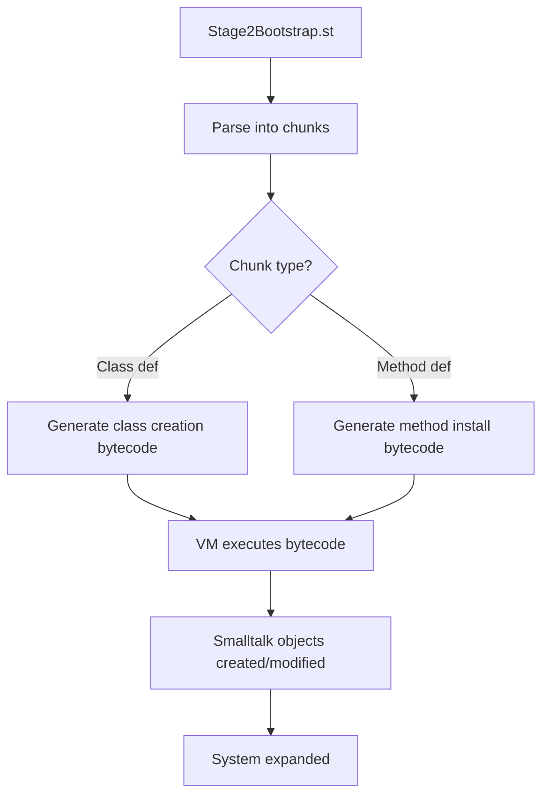

# Stage 2 Bootstrap via Bytecode Execution

## The Paradigm Shift

After Stage 1, we can transition from:
- **Low-level**: C# issuing VM primitives
- To **High-level**: C# executing Smalltalk bytecode

## Why This Works Now

### ✅ Critical Infrastructure Available

1. **Message Dispatch**
   - `perform:` and `perform:with:` work (primitives 83, 84)
   - Method lookup via `lookupSelector:in:`
   - Method dictionaries are functional

2. **Object Creation**
   - `basicNew` and `basicNew:` work (primitives 70, 71)
   - Classes can instantiate objects

3. **Method Installation**
   - `compile:` can install methods (primitive 117)
   - Method dictionaries accessible via `at:put:`

4. **Symbol & Dictionary**
   - Symbol interning works
   - Dictionary storage/retrieval operational

## The New Bootstrap Strategy

### Step 1: Create a Bytecode Executor in C#

```csharp
public class BytecodeBootstrapper
{
    private ISmalltalkVM vm;
    private Dictionary<string, int> globalOops = new();
    
    public void ExecuteStage2()
    {
        // Instead of primitive calls, execute Smalltalk!
        ExecuteSmalltalkCode(@"
            Object subclass: #Message
                instanceVariableNames: 'selector arguments'
                classVariableNames: ''
                poolDictionaries: ''
                category: 'Kernel-Methods'
        ");
        
        // Install methods by executing Smalltalk
        ExecuteSmalltalkCode(@"
            Message compile: 'selector
                ^selector'
        ");
    }
    
    private void ExecuteSmalltalkCode(string source)
    {
        // Compile to bytecode
        var bytecode = CompileToBytecode(source);
        
        // Execute in VM
        vm.ExecuteBytecode(bytecode);
    }
    
    private byte[] CompileToBytecode(string source)
    {
        // Simple bytecode generation for class creation
        var bytes = new List<byte>();
        
        if (source.Contains("subclass:"))
        {
            // Generate bytecode for class creation
            bytes.Add(PUSH_RECEIVER);     // Push superclass
            bytes.Add(PUSH_LITERAL);      // Push class name
            bytes.Add(PUSH_LITERAL);      // Push inst vars
            bytes.Add(SEND_SELECTOR);     // Send subclass:instanceVariableNames:...
            bytes.Add(RETURN_TOP);
        }
        else if (source.Contains("compile:"))
        {
            // Generate bytecode for method compilation
            bytes.Add(PUSH_RECEIVER);     // Push class
            bytes.Add(PUSH_LITERAL);      // Push source
            bytes.Add(SEND_SELECTOR);     // Send compile:
            bytes.Add(RETURN_TOP);
        }
        
        return bytes.ToArray();
    }
}
```

### Step 2: Minimal Bytecode Set

The VM needs to support these bytecodes:

| Bytecode | Operation | Description |
|----------|-----------|-------------|
| 0x70 | PUSH_RECEIVER | Push self onto stack |
| 0x71 | PUSH_TRUE | Push true |
| 0x72 | PUSH_FALSE | Push false |
| 0x73 | PUSH_NIL | Push nil |
| 0x10-0x1F | PUSH_TEMP | Push temporary variable |
| 0x20-0x2F | PUSH_LITERAL | Push literal from method |
| 0x60-0x6F | POP_STORE_TEMP | Pop and store in temp |
| 0x80-0x8F | SEND_SELECTOR | Send message |
| 0x7C | RETURN_TOP | Return top of stack |
| 0x7D | RETURN_RECEIVER | Return self |
| 0xB0-0xB7 | JUMP | Unconditional jump |
| 0xB8-0xBF | JUMP_FALSE | Jump if false |

### Step 3: Execute Smalltalk to Create Classes

```smalltalk
"This Smalltalk code is executed, not parsed by C#!"

"Create Message class"
| messageClass |
messageClass := Class new.
messageClass instVarAt: 1 put: Object.  "superclass"
messageClass instVarAt: 6 put: #Message.  "name"
messageClass instVarAt: 2 put: MethodDictionary new.  "methodDict"
messageClass instVarAt: 4 put: #('selector' 'arguments').  "inst vars"
Smalltalk at: #Message put: messageClass.

"Install method using Smalltalk"
messageClass compile: 'selector
    ^selector'.

"Create Boolean hierarchy"
Object subclass: #Boolean
    instanceVariableNames: ''
    classVariableNames: ''
    poolDictionaries: ''
    category: 'Kernel-Objects'.

Boolean subclass: #True
    instanceVariableNames: ''
    classVariableNames: ''
    poolDictionaries: ''
    category: 'Kernel-Objects'.

True compile: 'ifTrue: aBlock
    ^aBlock value'.
```

### Step 4: Load Stage2Bootstrap.st via Bytecode

```csharp
public void LoadStage2File(string filename)
{
    var source = File.ReadAllText(filename);
    var chunks = ParseFileIntoChunks(source);
    
    foreach (var chunk in chunks)
    {
        if (chunk.IsClassDefinition)
        {
            // Execute class creation via bytecode
            var bytecode = GenerateClassCreationBytecode(chunk);
            vm.ExecuteBytecode(bytecode);
        }
        else if (chunk.IsMethodDefinition)
        {
            // Execute method installation via bytecode
            var bytecode = GenerateMethodInstallBytecode(chunk);
            vm.ExecuteBytecode(bytecode);
        }
    }
}
```

## 🎯 Advantages of Bytecode Execution

### 1. **Leverage Existing Infrastructure**
- Use Smalltalk's own class creation protocol
- Method compilation handled by Smalltalk
- No need to replicate logic in C#

### 2. **Natural Smalltalk Semantics**
- Classes created the "Smalltalk way"
- Proper metaclass handling
- Correct slot initialization

### 3. **Simplified C# Code**
```csharp
// Before: Low-level primitive orchestration
int classId = vm.PrimitiveNewClass();
vm.PrimitiveSetSlot(classId, 1, superclassId);
vm.PrimitiveSetSlot(classId, 6, vm.PrimitiveInternSymbol("MyClass"));

// After: Execute Smalltalk bytecode
ExecuteSmalltalkCode("Object subclass: #MyClass ...");
```

## 📊 Bytecode Bootstrap Flow



## 🔧 Implementation Requirements

### VM Must Support:
1. **Bytecode interpreter** with basic instruction set
2. **Stack management** for method contexts
3. **Method lookup** and dispatch
4. **Primitive fallback** for operations like basicNew

### Bootstrapper Must:
1. **Parse** .st files into chunks
2. **Generate bytecode** for common patterns
3. **Execute bytecode** via VM
4. **Handle results** and errors

## 📈 Stage 2 Bytecode Patterns

### Class Creation Pattern
```
PUSH_GLOBAL     'Object'
PUSH_LITERAL    'MyClass'
PUSH_LITERAL    'instVars'
PUSH_LITERAL    'classVars'
PUSH_LITERAL    'pools'
PUSH_LITERAL    'category'
SEND_SELECTOR   'subclass:instanceVariableNames:classVariableNames:poolDictionaries:category:'
POP_STORE_GLOBAL 'MyClass'
```

### Method Installation Pattern
```
PUSH_GLOBAL     'MyClass'
PUSH_LITERAL    'methodSource'
SEND_SELECTOR   'compile:'
POP
```

### Object Creation Pattern
```
PUSH_GLOBAL     'OrderedCollection'
SEND_SELECTOR   'new'
DUP
PUSH_LITERAL    'item1'
SEND_SELECTOR   'add:'
POP
```

## 🎉 The Magic Moment

When the first class is created via bytecode execution rather than primitive calls, the system becomes truly self-hosting. From that point:

- **Smalltalk creates Smalltalk**
- **The VM just interprets**
- **C# orchestrates but doesn't construct**

This is the transition from **bootstrap** to **self-hosting**!

## Example: Creating OrderedCollection via Bytecode

```csharp
// Instead of this complex primitive orchestration:
int orderedCollectionId = vm.PrimitiveNewClass();
vm.PrimitiveSetSlot(orderedCollectionId, 0, sequenceableCollectionId);
vm.PrimitiveSetSlot(orderedCollectionId, 1, vm.PrimitiveNewDictionary());
// ... many more primitive calls ...

// We do this:
string code = @"
    SequenceableCollection subclass: #OrderedCollection
        instanceVariableNames: 'array firstIndex lastIndex'
        classVariableNames: ''
        poolDictionaries: ''
        category: 'Collections-Sequenceable'.
    
    OrderedCollection compile: 'add: anObject
        lastIndex := lastIndex + 1.
        array at: lastIndex put: anObject.
        ^anObject'.
";

ExecuteSmalltalkCode(code);
// Smalltalk handles ALL the details!
```

## Summary

Stage 2 via bytecode execution represents the crucial transition from external VM manipulation to internal Smalltalk execution. The bootstrapper becomes a **bytecode generator** rather than a **primitive orchestrator**, and Smalltalk takes over its own evolution!